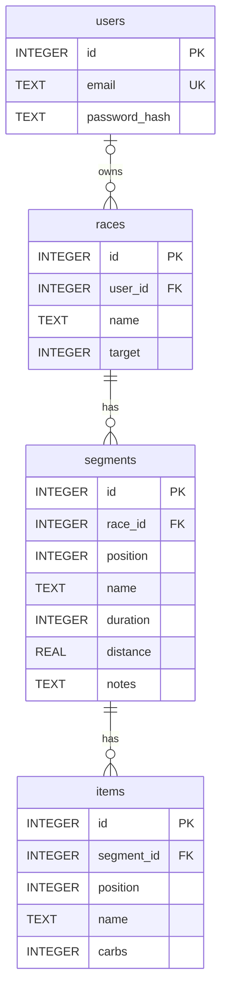

# Race Planner: Minimal Schema

Four tables: `users`, plus the app's `races > segments > items` data.



```sql
CREATE TABLE users (
  id             INTEGER PRIMARY KEY,
  email          TEXT NOT NULL UNIQUE,   -- store lowercased
  password_hash  TEXT NOT NULL           -- "iterations.salt.hash"
);

CREATE TABLE races (
  id          INTEGER PRIMARY KEY,
  user_id     INTEGER REFERENCES users(id),
  name        TEXT    NOT NULL,
  target      INTEGER NOT NULL DEFAULT 60 CHECK (target >= 0)  -- carbs g/hour
);

CREATE TABLE segments (
  id          INTEGER PRIMARY KEY,
  race_id     INTEGER NOT NULL REFERENCES races(id) ON DELETE CASCADE,
  position    INTEGER NOT NULL,                  -- order within race
  name        TEXT    NOT NULL,
  duration    INTEGER NOT NULL DEFAULT 0,        -- minutes
  distance    REAL,                              -- km, optional
  notes       TEXT    NOT NULL DEFAULT ''        -- pacing plan
);

CREATE TABLE items (
  id          INTEGER PRIMARY KEY,
  segment_id  INTEGER NOT NULL REFERENCES segments(id) ON DELETE CASCADE,
  position    INTEGER NOT NULL,                  -- eating order
  name        TEXT    NOT NULL,
  carbs       INTEGER NOT NULL CHECK (carbs >= 0) -- grams
);
```

## Not stored (computed)

- Carbs needed per segment: `duration / 60 * races.target`
- Carbs planned per segment: `SUM(items.carbs)`
- Race totals: sum of the above across segments
- Pace: `duration / distance`
